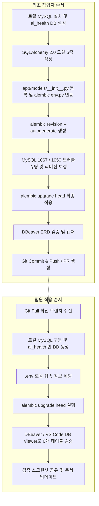

# 📋 DB 마이그레이션 전체 작업 순서 및 역할별 가이드

이 문서는 3일차 DB 마이그레이션 과제 진행 시 **최초 작업자(Lead/Setup)**가 진행한 전체 구축 과정과, 이후 **팀원(Teammates)**들이 각자의 로컬 환경에서 동일하게 스키마를 구성하기 위해 밟아야 하는 실행 순서를 정리한 가이드입니다.

---

## 1. 역할별 작업 흐름 요약



---

## 2. 최초 작업자(Lead) 상세 진행 서순

최초 구축자는 데이터베이스 설치부터 ORM 매핑, 마이그레이션 스크립트 생성 및 문법 충돌 해결까지 전체 파이프라인을 구축했습니다.

### Step 1. 로컬 데이터베이스 엔진 준비
1. Mac 환경에 MySQL Community Server 설치 및 서비스 구동
2. CLI를 통해 프로젝트 전용 데이터베이스 생성 (`utf8mb4` 문자셋 적용):
   ```bash
   /usr/local/mysql/bin/mysql -u root -p -e "CREATE DATABASE IF NOT EXISTS ai_health CHARACTER SET utf8mb4 COLLATE utf8mb4_unicode_ci;"
   ```

### Step 2. SQLAlchemy 2.0 ORM 도메인 모델 설계
1. `app/models/` 디렉터리에 도메인별 모델 분리 작성:
   * `users.py`: 의료진/관리자 계정, 역할(`role`), 활성화 여부(`is_active`)
   * `patients.py`: 환자 인적사항 (`name`, `age`, `gender`, `phone`)
   * `medical_records.py`: 진료 차트 정보 (`patient_id` FK 연결)
   * `xray_images.py`: X-ray 촬영 메타데이터 (`record_id`, `uploader_id` FK 연결)
   * `ai_analysis_results.py`: 폐렴 판독 결과 및 확신도 (`record_id` FK 연결)
2. `app/models/__init__.py`에서 모든 모델을 import하여 `Base.metadata`에 스키마 등록

### Step 3. Alembic 마이그레이션 스크립트 자동 생성
1. `alembic revision --autogenerate -m "Initial schema setup"` 실행
2. 생성된 버전 파일(`alembic/versions/xxxx_initial_schema_setup.py`) 생성 확인

### Step 4. 실행 및 트러블슈팅 (핵심 디버깅)
1. **1차 시도 실패 (Error 1067)**:
   * `users.is_active` 불리언 컬럼의 기본값이 MySQL 문법에 맞지 않아 중단됨.
   * `sa.text('1')` 및 파이썬 모델 `server_default` 보정 완료.
2. **2차 시도 실패 (Error 1050)**:
   * MySQL DDL의 Implicit Commit 특성으로 인해 앞선 `patients` 테이블만 DB에 생성된 채 중단되어 "Table already exists" 에러 발생.
   * `DROP DATABASE ai_health; CREATE DATABASE ai_health...`로 로컬 스키마를 초기화하고 클린 상태 복구.
3. **최종 적용 성공**:
   * `alembic upgrade head` 재실행으로 5개 비즈니스 테이블 + `alembic_version` 총 6개 테이블 안착 완료.

### Step 5. DB Viewer 검증 및 문서화
1. **DBeaver**를 연결하여 외래키 연결선과 엔터티 관계도(ERD)가 정상적으로 렌더링되는지 확인.
2. 과제 제출용 다이어그램 캡처 확보 및 마크다운 보고서(`docs/3일차_db_migration.md`) 작성.
3. 원격 저장소(`develop` 브랜치)로 커밋 및 푸시.

---

## 3. 팀원(Teammates) 상세 실행 서순

팀원은 모델 코드를 새로 작성하거나 마이그레이션 스크립트를 새로 파지(`alembic revision`) 않습니다. 리드가 푸시한 버전 스크립트를 **본인 로컬 DB에 반영(Upgrade)만 수행**합니다.

### Step 1. 최신 코드 수신 (Git Pull)
```bash
git checkout develop
git pull origin develop
```

### Step 2. 로컬 MySQL 설치 및 데이터베이스 생성
팀원의 OS 환경에 맞추어 MySQL을 구동하고 `ai_health` 스키마를 생성합니다.

* **Mac (Homebrew)**:
  ```bash
  brew install mysql && brew services start mysql
  mysql -u root -p -e "CREATE DATABASE IF NOT EXISTS ai_health CHARACTER SET utf8mb4 COLLATE utf8mb4_unicode_ci;"
  ```
* **Windows (PowerShell / CMD)**:
  * MySQL Installer(MSI) 설치 또는 `winget install Oracle.MySQL`
  * MySQL 서비스 구동 확인 후 DB 생성:
    ```powershell
    mysql -u root -p -e "CREATE DATABASE IF NOT EXISTS ai_health CHARACTER SET utf8mb4 COLLATE utf8mb4_unicode_ci;"
    ```

### Step 3. 환경 변수(`.env`) 동기화
프로젝트 루트의 `.env` 파일에 본인 로컬 MySQL 계정 및 비밀번호를 기입합니다.
```env
DB_HOST=127.0.0.1
DB_PORT=3306
DB_USER=root
DB_PASSWORD=본인_mysql_비밀번호
DB_NAME=ai_health
```

### Step 4. 가상환경 활성화 및 마이그레이션 실행
새로운 리비전을 생성하지 않고, **`upgrade head`만 단일 실행**합니다.

```bash
# [가상환경 활성화]
# Mac:
source .venv/bin/activate
# Windows:
# .venv\Scripts\activate

# [마이그레이션 적용]
alembic upgrade head
```

> ⚠️ **주의사항**: 팀원이 `alembic revision --autogenerate`를 실행하면 마이그레이션 버전 트리(브랜치)가 갈라져 버전 충돌이 발생할 수 있으므로, 반드시 `upgrade head`만 수행합니다.

### Step 5. 검증 및 결과 공유
1. DBeaver 또는 VS Code Database Client로 `localhost:3306 / ai_health`에 연결합니다.
2. 아래 6개 테이블이 정상 노출되는지 확인합니다:
   * `ai_analysis_results`
   * `alembic_version`
   * `medical_records`
   * `patients`
   * `users`
   * `xray_images`
3. 테이블 목록 또는 ERD 화면을 캡처하여 팀 문서(`docs/3일차_db_migration.md`)의 팀원 확인란에 등록합니다.