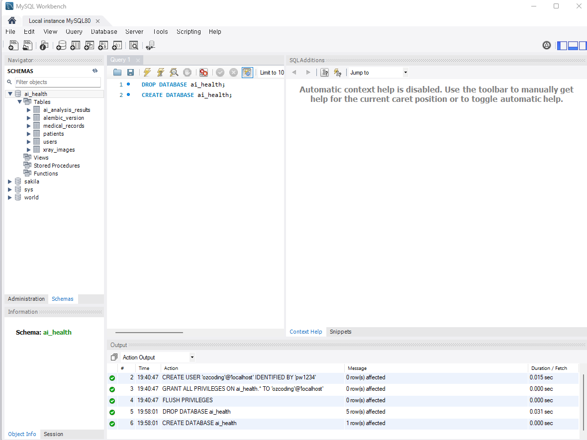

# 3일차 DB Model 및 Migration

## 1. Database 구성

이번 과제에서는 주어진 ERD를 참고하여 SQLAlchemy ORM으로 Database Model을 작성하고, Alembic Migration을 통해 실제 MySQL Database에 Schema를 적용하였다.

- Database: MySQL
- Database Name: `ai_health`
- ORM: SQLAlchemy
- Migration Tool: Alembic
- DB Viewer: MySQL Workbench

---

## 2. SQLAlchemy Model 작성

ERD를 기준으로 `app/models/` 하위에 각 테이블에 해당하는 SQLAlchemy Model을 작성하였다.

### 생성한 파일

- `enums.py`
- `users.py`
- `patients.py`
- `medical_records.py`
- `xray_images.py`
- `ai_analysis_results.py`

### Model 파일 구조

```text
app/
└── models/
    ├── __init__.py
    ├── enums.py
    ├── users.py
    ├── patients.py
    ├── medical_records.py
    ├── xray_images.py
    └── ai_analysis_results.py
```

`app/models/__init__.py`에서 작성한 Model Class들을 import하여 SQLAlchemy의 `Base.metadata`에 Model이 등록될 수 있도록 구성하였다.

---

## 3. Enum 구성

ERD에 정의된 값을 기준으로 Enum을 작성하였다.

### Gender

- `M`
- `F`

### Department

- `MEDICAL`
- `DEV`
- `RESEARCH`

### Role

- `PENDING`
- `STAFF`
- `ADMIN`

실제 Model에서는 해당 Enum을 사용하여 컬럼에 저장할 수 있는 값을 제한하였다.

---

## 4. Model 관계 설정

ERD를 기준으로 각 테이블의 Primary Key와 Foreign Key 관계를 설정하였다.

```text
patients
   ↓
medical_records
   ↓
├── xray_images
└── ai_analysis_results

users
   ↓
xray_images
```

주요 Foreign Key 관계는 다음과 같다.

- `medical_records.patient_id` → `patients.id`
- `xray_images.record_id` → `medical_records.id`
- `xray_images.uploader_id` → `users.id`
- `ai_analysis_results.record_id` → `medical_records.id`

이를 통해 각 Model 간의 관계를 Database 수준에서 연결하였다.

---

## 5. Alembic Migration

작성한 SQLAlchemy Model을 실제 MySQL Database Schema에 적용하기 위해 Alembic을 사용하였다.

### Migration 파일 생성

다음 명령어를 사용하여 SQLAlchemy Model을 기준으로 Migration 파일을 자동 생성하였다.

```bash
alembic revision --autogenerate -m "create database models"
```

최종 생성된 Migration 파일은 다음과 같다.

```text
alembic/versions/ec732e72885f_create_database_models.py
```

Alembic은 현재 Database와 SQLAlchemy의 `Base.metadata`에 등록된 Model을 비교하여 필요한 테이블 생성 정보를 Migration 파일에 작성한다.

---

## 6. Migration 적용

생성된 Migration 파일을 실제 MySQL Database에 적용하기 위해 다음 명령어를 실행하였다.

```bash
alembic upgrade head
```

이를 통해 SQLAlchemy에서 작성한 Model 구조를 MySQL의 `ai_health` Database에 적용하였다.

---

## 7. Migration 과정에서 발생한 문제 및 해결

최초 Migration을 적용하는 과정에서 `xray_images` 테이블의 Foreign Key 생성 시 오류가 발생하였다.

원인은 다음 두 컬럼의 데이터 타입이 서로 달랐기 때문이다.

```text
users.id                 → Integer
xray_images.uploader_id  → BigInteger
```

`xray_images.uploader_id`는 `users.id`를 Foreign Key로 참조하고 있었기 때문에 MySQL에서 Foreign Key를 생성하는 과정에서 타입이 호환되지 않는다는 오류가 발생하였다.

따라서 `xray_images.uploader_id`의 타입을 다음과 같이 수정하였다.

```text
수정 전

users.id                 → Integer
xray_images.uploader_id  → BigInteger


수정 후

users.id                 → Integer
xray_images.uploader_id  → Integer
```

Model 수정 후 기존 Migration 파일을 정리하고 수정된 Model을 기준으로 Migration 파일을 다시 생성하였다.

```bash
alembic revision --autogenerate -m "create database models"
```

이후 다시 Migration을 적용하였다.

```bash
alembic upgrade head
```

수정 후에는 Foreign Key 오류 없이 Migration이 정상적으로 완료되었다.

---

## 8. 최종 Database Schema

Migration 완료 후 MySQL Workbench에서 `ai_health` Database의 Schema를 확인하였다.

최종적으로 다음 테이블이 생성되었다.

- `users`
- `patients`
- `medical_records`
- `xray_images`
- `ai_analysis_results`
- `alembic_version`

`alembic_version`은 직접 작성한 Model에 해당하는 테이블이 아니라 Alembic이 현재 Database에 적용된 Migration Version을 관리하기 위해 사용하는 테이블이다.

---

## 9. DB Migration 결과

MySQL Workbench에서 Migration 적용 후 테이블이 정상적으로 생성된 것을 확인하였다.



---

## 10. 최종 정리

이번 과제에서는 다음과 같은 순서로 Database Model 작성 및 Migration을 진행하였다.

```text
ERD 확인
   ↓
SQLAlchemy Model 작성
   ↓
Primary Key / Foreign Key 설정
   ↓
Model 등록
   ↓
Alembic Migration 파일 생성
   ↓
MySQL Database에 Migration 적용
   ↓
Foreign Key 타입 오류 확인
   ↓
Model 수정
   ↓
Migration 재생성 및 적용
   ↓
MySQL Workbench에서 Schema 확인
```

SQLAlchemy를 이용하여 Python 코드로 Database Table 구조를 정의하고, Alembic을 이용하여 Model의 구조를 실제 MySQL Database Schema에 반영하였다.

최종적으로 ERD를 기반으로 작성한 `users`, `patients`, `medical_records`, `xray_images`, `ai_analysis_results` Model을 `ai_health` Database에 정상적으로 적용하고 MySQL Workbench에서 생성된 테이블을 확인하였다.