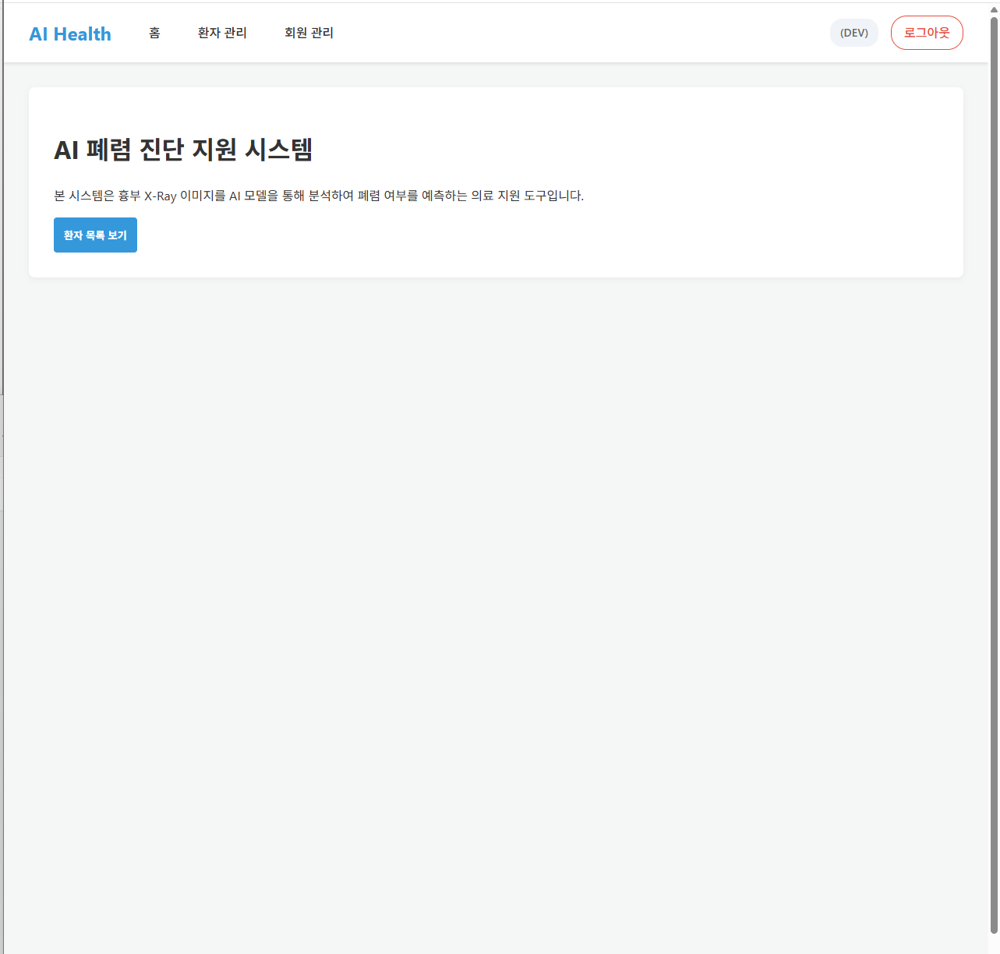
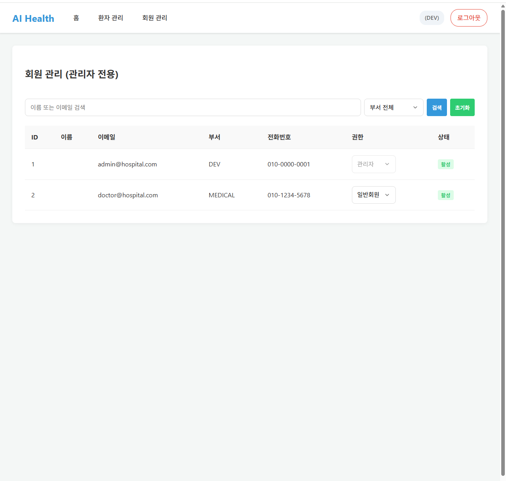
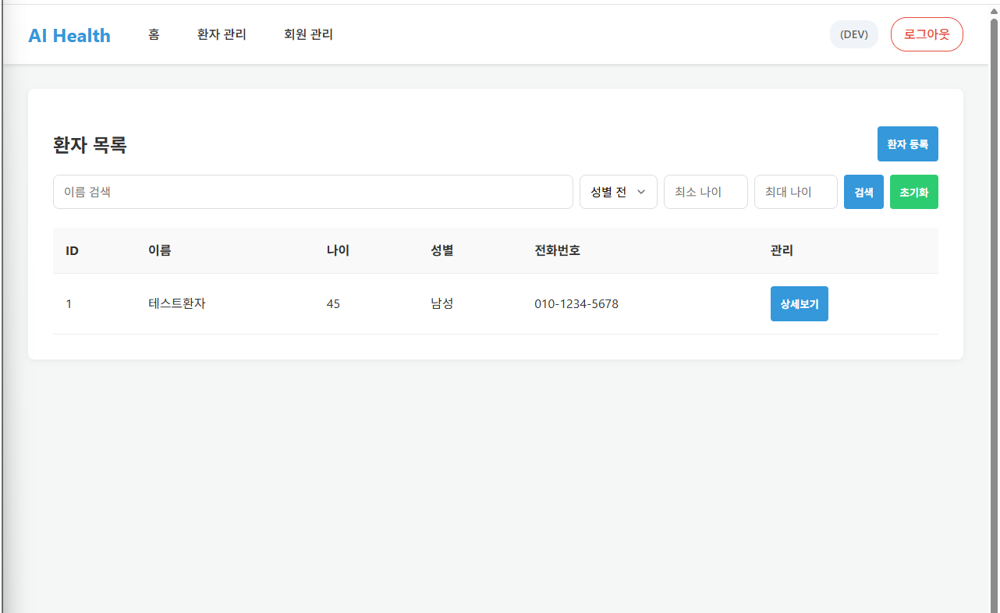
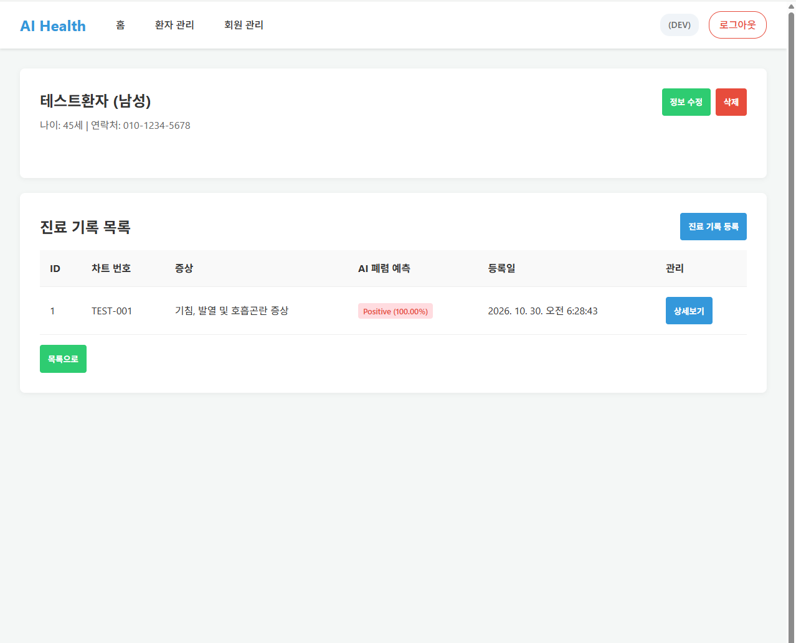
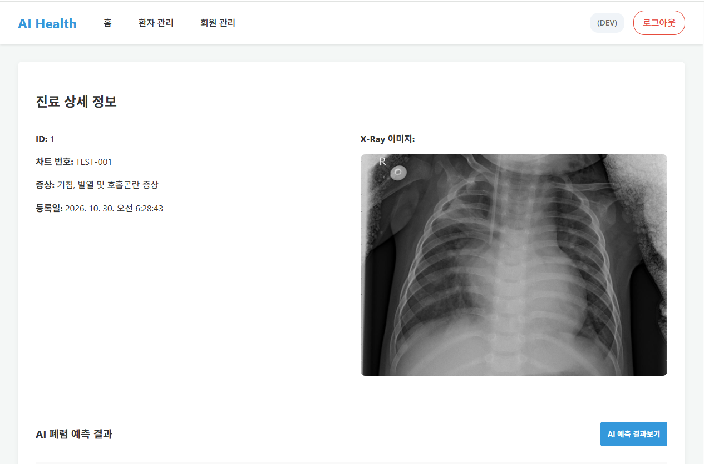
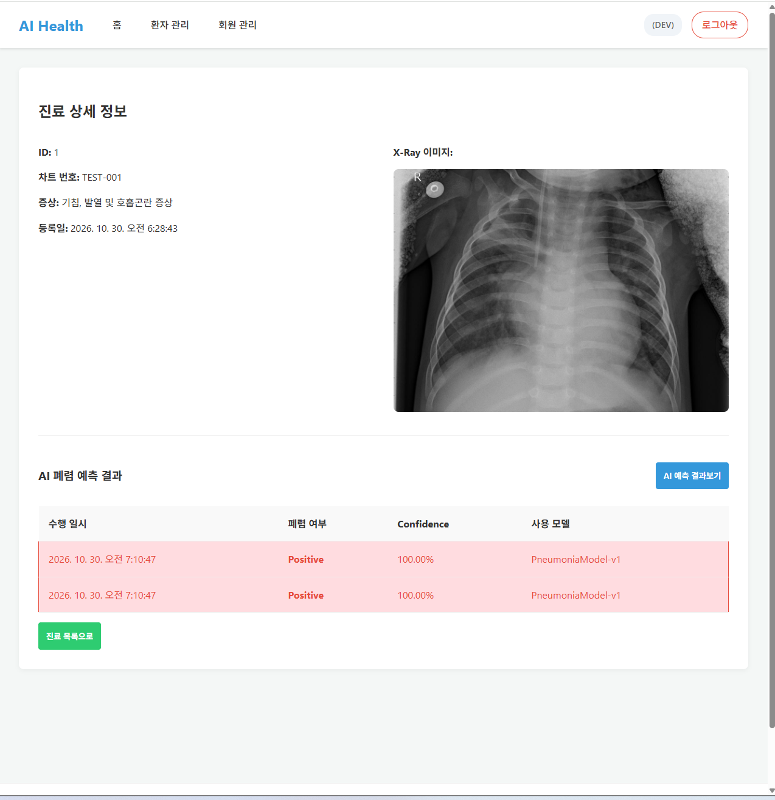

# 7일차 앱 실행 화면

## 1. 프로젝트 실행

FastAPI 서버와 MySQL 데이터베이스를 실행한 후 웹 브라우저에서 애플리케이션에 접속하여 프론트엔드와 API 연동 상태를 확인하였다.

```bash
uv run uvicorn app.main:app --reload
```

접속 주소:

```text
http://127.0.0.1:8000/
```

---

## 2. 로그인 및 홈 화면

관리자 계정으로 로그인하여 정상적으로 홈 화면에 접근되는 것을 확인하였다.

### 확인 API

- `POST /api/v1/users/login`
- `GET /api/v1/users/me`

### 실행 결과

- 관리자 로그인 정상 동작
- 로그인 후 홈 화면 이동 정상
- 사용자 정보 정상 표시



---

## 3. 회원 관리

관리자 계정으로 회원 관리 페이지에 접근하여 등록된 회원 목록을 조회하였다.

### 확인 API

- `GET /api/v1/admin/users`

### 실행 결과

- 관리자 권한으로 회원 관리 페이지 접근 성공
- 등록된 회원 목록 조회 정상
- 회원의 이름, 이메일, 부서, 권한 및 활성 상태 표시 정상



---

## 4. 환자 관리

환자 관리 페이지에서 환자 목록 조회 및 신규 환자 등록 기능을 테스트하였다.

### 확인 API

- `GET /api/v1/patients`
- `POST /api/v1/patients`
- `GET /api/v1/patients/{patient_id}`

### 실행 결과

- 환자 목록 조회 정상
- 신규 환자 등록 정상
- 등록한 환자의 상세 정보 조회 정상

테스트 환자를 등록한 후 환자 상세 페이지에서 이름, 나이, 성별, 전화번호 등의 정보가 정상적으로 표시되는 것을 확인하였다.





---

## 5. 진료 기록 및 X-Ray 이미지

등록한 환자에게 새로운 진료 기록을 추가하고 X-Ray 이미지를 업로드하였다.

### 확인 API

- `GET /api/v1/patients/{patient_id}/medical-records`
- `POST /api/v1/medical-records`
- `GET /api/v1/medical-records/{record_id}`
- `GET /api/v1/medical-records/{record_id}/analyses`

### 실행 결과

- 진료 기록 등록 정상
- 차트번호 및 증상 정보 저장 정상
- X-Ray 이미지 업로드 정상
- 진료 기록 상세 페이지에서 X-Ray 이미지 표시 정상



---

## 6. AI 폐렴 예측

등록된 진료 기록의 X-Ray 이미지를 이용하여 폐렴 AI 예측 기능을 실행하였다.

### 확인 API

- `POST /api/v1/medical-records/{record_id}/predictions`
- `GET /api/v1/patients/{patient_id}/predictions`

### 실행 결과

AI 모델이 정상적으로 실행되었으며 예측 결과가 화면에 표시되는 것을 확인하였다.

테스트 실행 결과:

- 폐렴 여부: `Positive`
- Confidence: `100.00%`
- 사용 모델: `PneumoniaModel-v1`


---

## 7. 최종 확인

프론트엔드 화면과 FastAPI API를 연결하여 주요 기능을 직접 테스트하였다.

확인한 기능:

- 관리자 로그인
- 사용자 정보 조회
- 회원 관리
- 환자 목록 조회
- 환자 등록
- 환자 상세 조회
- 진료 기록 등록
- X-Ray 이미지 업로드 및 조회
- AI 폐렴 예측 실행 및 결과 조회

각 기능이 프론트엔드에서 API를 호출하여 정상적으로 동작하는 것을 확인하였다.